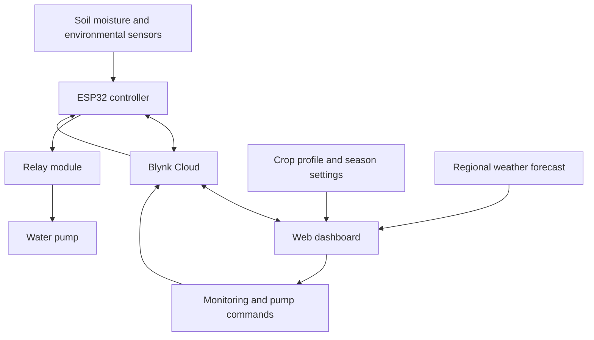

# Smart Irrigation & Multi-Layer Farming System

<p align="center">
  <strong>TEAM PROTOTYPE · IX-F</strong><br>
  An IoT-based farming prototype combining smart irrigation, sensor monitoring and a multi-layer growing setup.
</p>

<p align="center">
  
  
  
</p>

---

## Overview

The **Smart Irrigation & Multi-Layer Farming System** is a school team prototype designed to demonstrate how connected sensors and automated control can support water management in farming.

An ESP32 collects soil-moisture and environmental readings. The dashboard presents the system status and provides irrigation controls. In automatic mode, the irrigation decision uses the selected crop profile, season and soil-moisture target. The physical prototype also demonstrates multi-layer cultivation and a rainwater-harvesting concept.

This repository contains the project presentation website, the browser-based monitoring and control dashboard, and an Expo application workspace.

## Project highlights

- **Soil-moisture monitoring:** displays the moisture reading received from the ESP32.
- **Automatic irrigation logic:** uses a moisture threshold selected through crop and season profiles.
- **Manual pump control:** provides a dashboard control when the connected hardware is available.
- **Environmental readings:** displays temperature and humidity from the connected sensor.
- **Sensor trends:** keeps a recent in-session history for the dashboard charts.
- **Bilingual interface:** English and Hindi dashboard labels.
- **Regional weather outlook:** optional forecast information from Open-Meteo, shown separately from live hardware sensor readings.
- **Multi-layer farming concept:** demonstrates growing space arranged in multiple levels.
- **Rainwater harvesting concept:** includes a roof collection and filtration idea in the physical model.

## System overview



The web dashboard communicates with the ESP32 through Blynk Cloud. Regional weather information is a separate forecast source and is not represented as a reading from the farm sensors.

## Repository layout

```text
Smart-Farming-IoT/
├── index.html          # Project overview and presentation website
├── app/
│   ├── index.html      # Smart Farm monitoring and control dashboard
│   ├── app.js          # Dashboard logic and Blynk communication
│   └── style.css       # Dashboard styling
└── FarmApp/            # Expo / React Native application workspace
```

## Hardware used in the prototype

The physical model was built around an ESP32 and included:

| Component | Role |
| --- | --- |
| ESP32 development board | Main controller and Wi-Fi connection |
| Soil-moisture sensor | Measures soil moisture |
| DHT11 sensor | Reads ambient temperature and humidity |
| Relay module | Switches the pump circuit |
| Water pump | Moves water through the irrigation line |
| OLED display | Local system information |
| Multi-layer growing structure | Demonstrates vertical growing levels |
| Rainwater collection and filter model | Demonstrates rainwater harvesting |

The exact wiring and power arrangement can vary with the components used. Check the circuit and module ratings before assembling or powering the hardware.

## Dashboard setup

1. Open `app/index.html` in a browser or serve the repository using a local static web server.
2. Configure the ESP32 firmware and Blynk device so the virtual pins match the dashboard.
3. Configure Blynk credentials through a secure private setup. The public repository intentionally does not contain a device token.
4. Connect the ESP32 to Wi-Fi and confirm that the device appears online in Blynk.
5. Open the dashboard and check the connection status and incoming sensor values.

### Blynk virtual pin map

The dashboard currently expects these virtual pins:

| Virtual pin | Purpose |
| --- | --- |
| V0 | Pump command / state |
| V1 | Temperature |
| V2 | Humidity |
| V4 | Soil moisture |
| V5 | Automatic / manual mode |
| V6 | Season profile |
| V7 | Crop profile |
| V8 | Custom soil-moisture target |

The ESP32 firmware and Blynk datastream configuration must use the same mapping.

### Automatic irrigation concept

The dashboard contains default moisture targets for the available crop profiles:

| Season | General crops | Leafy plants | Vegetables |
| --- | ---: | ---: | ---: |
| Summer | 55% | 65% | 60% |
| Winter | 45% | 55% | 50% |

These are configurable prototype values, not universal agronomic recommendations. The automatic control logic compares the incoming soil-moisture reading with the selected target.

## Running the Expo workspace

The `FarmApp/` directory contains an Expo / React Native project workspace.

```bash
cd FarmApp
npm install
npx expo start
```

Use the Expo terminal instructions to open the app on a supported device, emulator or web target. This workspace is separate from the browser dashboard.

## Security note

Do not commit Blynk authentication tokens, Wi-Fi passwords or other credentials to a public repository. A token placed in browser-side JavaScript can be viewed by visitors. For a publicly hosted dashboard, route authenticated requests through a secure backend rather than embedding a private token in the page.

## Credits

**TEAM PROTOTYPE · IX-F**

A collaborative school project involving hardware prototyping, software development, dashboard design and project presentation.

---

<p align="center"><sub>Smart Irrigation & Multi-Layer Farming System · Team Prototype IX-F</sub></p>
